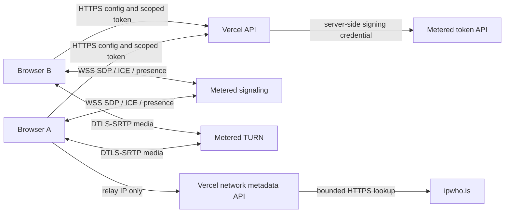

# Architecture And Module Map

MediaCall is a TypeScript/React WebRTC client with interchangeable signaling and relay infrastructure. UI state, call lifetime, network metrics, HTTP handling, and relay packet processing have separate owners.

## Runtime Modes

| Runtime | Frontend/API | Signaling | Media relay |
| --- | --- | --- | --- |
| Local `--turn custom-turn` | Node + Vite, or built assets with `--production` | Local WebSocket rooms | Repository `custom-turn` |
| Local `--turn metered`, signing keys | Node + Vite/built assets | Official Metered SDK to provider | Metered Open Relay |
| Local `--turn metered`, TURN REST key | Node + Vite/built assets | Local WebSocket rooms | Metered Open Relay |
| Vercel `CALL_BACKEND=hosted`, signing keys | Vercel static assets + Node function | Metered managed signaling | Metered Open Relay |
| Hosted alternate, Neon + TURN REST | Vercel function | Cursor-based HTTP/SQL rooms | Metered Open Relay |
| Vercel external proxy | Vercel + fixed BACKEND_URL | External backend WSS | That backend's selected relay |

Automatic ICE is the initial UI selection unless explicitly overridden by a local CLI/environment setting. It permits direct or relayed routes; it does not promise a direct route. Any participating user choosing Force TURN causes the room to use relay-only configuration before negotiation.

## Hosted Topology

With Automatic ICE, browsers can select a direct path instead of R. Vercel does not carry the audio/video payload or host a UDP allocation listener.

## Client Ownership

| Module | Responsibility |
| --- | --- |
| [App.tsx](../src/client/App.tsx) | Small composition root and workspace header |
| [components](../src/client/components/CallMedia.tsx) | Call media, session controls, settings, relay console, real-time stats |
| [useWorkspace](../src/client/hooks/useWorkspace.ts) | Config/health polling, invitation workflow, modal and device-selection state |
| [useCall](../src/client/hooks/useCall.ts) | getUserMedia, RTCPeerConnection lifetime, negotiation, media actions, signaling events |
| [useConnectionStats](../src/client/hooks/useConnectionStats.ts) | One-second getStats sampling, 60-sample history, route-change events |
| [webrtc/stats](../src/client/webrtc/stats.ts) | Pure selected-pair/RTP parsing and delta calculations |
| [signaling](../src/client/signaling/connection.ts) | Local WebSocket, hosted HTTP, and official SDK adapters |
| [services](../src/client/services/callApi.ts) | HTTP credential/config boundaries and invitation parsing |
| [styles](../src/client/styles.css) | Ordered CSS entry importing base, layout, media, session, dialogs, diagnostics, responsive modules |

The call hook does not decide which IP location provider to use, and the stats collector does not mutate peer connections. A stats reset follows peer disposal, preventing negative rates or stale endpoints from a previous call.

## Server Ownership

| Directory | Responsibility |
| --- | --- |
| [config](../src/server/config/startup.ts) | CLI/environment validation and optional interactive startup |
| [providers](../src/server/providers/local.ts) | Local provider construction and shutdown |
| [http](../src/server/http/localApi.ts) | HTTP headers, JSON/auth helpers, static serving, rate buckets, local API |
| [custom-turn](custom-turn.md) | Custom STUN/TURN protocol and data path |
| [signaling](../src/server/signaling/websocket.ts) | Bounded local two-party WebSocket rooms |
| [hosted](../src/server/hosted/api.ts) | Managed token API, TURN REST credentials, alternate SQL rooms, fixed-backend proxy |
| [network](../src/server/network/location.ts) | Validated relay-IP GeoIP lookup, caching, response normalization |

[src/server/index.ts](../src/server/index.ts) composes those modules. [api/[...path].ts](../api/%5B...path%5D.ts) is the Vercel entry point. Production secrets remain server-side.

## State And Trust

Local WebSocket rooms are process-local. Alternate hosted HTTP rooms live in PostgreSQL JSONB and use optimistic compare-and-swap to avoid lost updates. The recommended Metered path delegates roster/presence persistence to the provider and requires no Neon resource.

Room IDs are high-entropy invite capabilities, not authenticated personal identities. In managed mode, two-party behavior is enforced by the application's provider-presence roster; the provider channel itself is not a strict two-subscriber authorization boundary. A maliciously modified client is outside the demo's identity/authentication guarantees.

Provider-signed tokens are scoped to one `mediacall/<roomId>` channel for one hour, with publish/subscribe/presence permissions. Unrestricted direct-send permission is unnecessary. The provider signaling service and configured backend are trusted for SDP/fingerprint exchange; the app does not independently verify human identities.