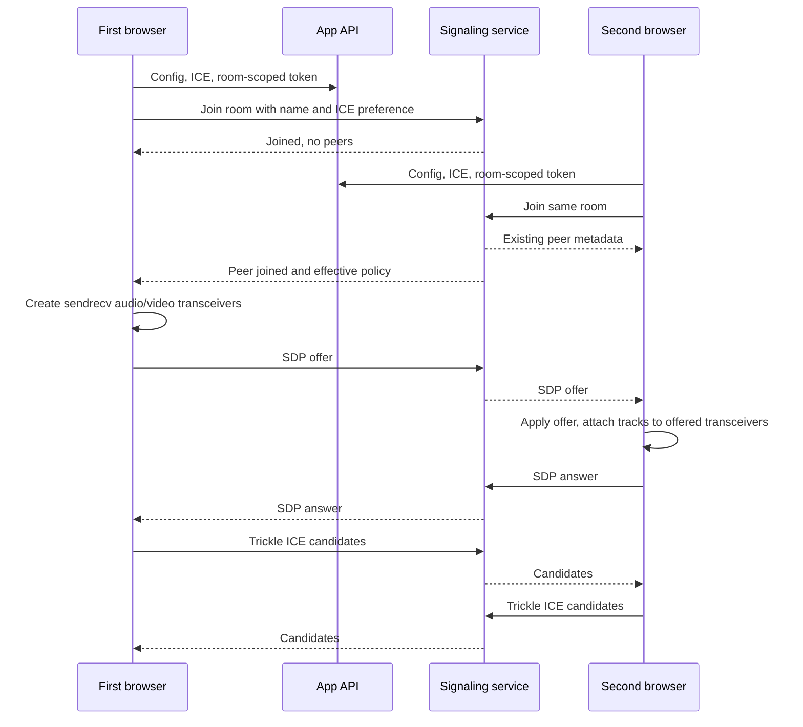

# End-To-End Call Flow

## 1. Workspace Setup

The client loads `/api/config` and periodically checks `/api/health` and authorized relay metadata. Initial ICE selection is Automatic. A user can choose Force TURN before entering a room. Room policy becomes immutable for the established negotiation; switching the UI is disabled during an active call.

The user creates a random room ID or follows a same-origin `?room=...` invite. Display names are bounded and rendered as text. Audio/video capture starts only through user interaction. Audio-only mode does not request camera capture.

## 2. Infrastructure Configuration

The client requests `/api/ice`.

- Local custom-turn: it receives local STUN/TURN URLs and temporary long-term credentials.
- Metered TURN REST plus WebSocket/HTTP signaling: it receives provider ICE servers fetched by the server, not a provider API key.
- Metered signing-key mode: it receives a managed-signaling descriptor. The browser calls `/api/realtime` with room/name/mode, then the official SDK connects with the returned short-lived token. TURN credentials arrive in the authenticated welcome event.

The app refuses managed negotiation when no authenticated TURN server is injected. It does not silently replace Force TURN with direct ICE.

## 3. Peer Discovery And Policy

The first peer initiates offers. The joining peer is polite for offer-collision handling. Incoming ICE is queued until a remote description exists. The responder attaches tracks to offered transceivers rather than creating duplicate unnegotiated ones.

If either peer requested relay, both create `RTCPeerConnection` with `iceTransportPolicy: 'relay'`; otherwise the policy is `'all'`. `bundlePolicy: 'max-bundle'` shares transport where negotiation allows.

## 4. ICE And TURN

Automatic mode lets the browser gather and evaluate host, server-reflexive, and relay candidates. ICE chooses a working pair according to browser priorities and connectivity, not a hard-coded UI assumption.

Force TURN uses authenticated relay candidates. Both peers typically allocate on the configured service; one may get a different IP or relay port from the other. The browser authorizes peer destinations and uses Send/Data indications or bound ChannelData. In custom-turn, the allocation details are documented in [custom-turn](custom-turn.md).

The connection's selected candidate-pair report is the evidence of the media route. A hostname in application config or a successful credentials request is not proof of media relay.

## 5. Media And Diagnostics

DTLS exchanges browser fingerprints negotiated through signaling. SRTP encrypts audio/video between the browsers. TURN forwards opaque media datagrams and does not receive microphone/camera plaintext.

The UI binds remote tracks to a MediaStream and a playsInline video element; it offers an audio-play action if autoplay is blocked. Audio metering uses a local Web Audio analyser, not uploaded audio samples.

The stats hook samples the actual connection every second, identifies the transport-selected pair, derives RTP deltas, and retains 60 samples. The relay console shows both candidate endpoints. Only relay IPs are sent to the optional location endpoint; no lookup is made for direct-peer candidates. See [Diagnostics](diagnostics.md).

## 6. User Actions

Mute toggles the audio track's enabled flag. Camera toggle disables/enables or reacquires a camera track. Device selection replaces the relevant sender track. Screen sharing captures video at a constrained frame rate and replaces the negotiated video sender; stopping restores the camera track. System audio sharing is not implemented.

Audio/video/sharing state is signaled to the peer so the other UI reflects changes. A screen share does not require adding a new media transport.

## 7. Failure And Cleanup

Network disconnect/failed states surface Reconnecting. The local negotiation controller makes bounded ICE-restart attempts; a manual reconnect action is available when relevant. Managed provider socket loss/token expiry requires rejoining rather than an unbounded hidden reconnect loop. One-hour provider-token duration is a real demo limit.

Leaving sends a leave/close, closes the peer and signaling connection, stops all captured and shared tracks, resets stats/history, and leaves the other peer waiting. Unmount performs equivalent resource cleanup. UDP TURN allocations can outlive a closed browser until the server's allocation timer expires.