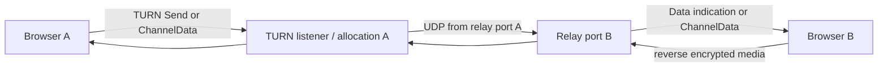

# custom-turn Internals

The implementation is in [src/server/custom-turn](../src/server/custom-turn/server.ts). It implements the IPv4 STUN/TURN packet and relay path directly with Node `dgram`, `net`, `tls`, and `crypto`. It does not wrap coturn or a hosted relay.

It is a deliberately bounded implementation, not a fully certified RFC implementation or a demonstrated performance/security replacement for coturn.

## Modules

| Module | Responsibility |
| --- | --- |
| [protocol.ts](../src/server/custom-turn/protocol.ts) | STUN header/TLV parsing, padding, message integrity, CRC fingerprint, XOR IPv4 encoding |
| [auth.ts](../src/server/custom-turn/auth.ts) | REST-style temporary credentials, long-term authentication keys, signed nonces |
| [server.ts](../src/server/custom-turn/server.ts) | Client transports, allocation lifecycle, permissions, channels, byte forwarding, quotas |
| [local.ts](../src/server/providers/local.ts) | App integration, URLs and credentials exposed to the browser |

The SOFTWARE attribute identifies this implementation as `custom-turn/0.1`.

## Wire Processing

A STUN packet has a 20-byte header containing the message type, padded attribute-body length, magic cookie `0x2112a442`, and a 12-byte transaction ID. Attributes are type-length-value records, padded to four-byte boundaries. Attribute padding is included in the integrity calculation and can be nonzero.

The decoder requires exact packet length, valid magic cookie, aligned message length, and complete TLVs. If a FINGERPRINT attribute exists it must be the final attribute and match CRC-32 XOR `0x5354554e`. It is not a cryptographic signature.

Authenticated control requests contain exactly one MESSAGE-INTEGRITY attribute. HMAC-SHA1 covers the correct prefix with the STUN header length adjusted to end at MESSAGE-INTEGRITY. Attributes after the integrity record are rejected except FINGERPRINT, preventing unsigned request parameters from changing allocation behavior. Unknown comprehension-required attributes return 420.

Supported methods are Binding, Allocate, Refresh, CreatePermission, ChannelBind, and Send/Data indications. ChannelData is a separate compact frame, recognized by its leading channel-number range.

## Credentials And Nonces

The local credential endpoint generates a username in the form:

```text
username   = expiryUnixSeconds + ':' + 12 random bytes encoded as hex
password   = Base64(HMAC-SHA1(TURN_SECRET, username))
integrity  = MD5(username + ':' + realm + ':' + password)
```

The MD5 output is the standard RFC 5766 long-term MESSAGE-INTEGRITY key derivation, not a password database hash. The default realm is `mediacall`. The default issued credential TTL is one hour, configurable from 60 seconds to one day.

An unauthenticated Allocate receives 401 with REALM and NONCE. The browser retries with USERNAME, REALM, NONCE, and MESSAGE-INTEGRITY. A nonce contains timestamp, random material, and HMAC-SHA256 bound to the client's source IP. The server distinguishes invalid nonces from correctly signed but stale ones. Nonces expire after 600 seconds; stale authenticated requests receive 438. Future timestamps beyond the allowed skew are rejected.

Expired credentials cannot create allocations. An existing allocation may continue authenticated refreshes with its original username so an established call is not forcibly terminated when the original credential expires.

## Allocation Ownership

Each allocation owns one bound UDP relay socket. The client-to-server transport may be UDP, TCP, or TLS; the peer-facing transport remains UDP.

An allocation stores:

```text
transport identity -> {
  client endpoint / response writer,
  authenticated username,
  bound UDP relay socket and allocated port,
  allocation expiry,
  peer-IP permission expiries,
  channel-number -> peer IP:port mappings,
  shared ingress/egress bandwidth token bucket
}
```

UDP identity is `udp:<source-ip>:<source-port>` within one server instance/listener. TCP and TLS identities are unique connection serials. Changing the client's UDP source port or reconnecting TCP creates a different transport identity, not ownership of the old allocation.

The server validates UDP REQUESTED-TRANSPORT (`17`) and IPv4 address family. TCP peer allocations and port reservations are explicitly unsupported. It checks global and per-client-IP quotas, counting allocations still waiting for a socket as well as completed ones. A pending map prevents concurrent allocation attempts from consuming duplicate capacity.

Ports are attempted sequentially through the configured range, wrapping at its end. Busy ports are skipped. The socket binds to `TURN_RELAY_BIND_IP`. Exhausting the range returns 508. The effective allocation limit is the smaller of the configured maximum and the number of ports in the range.

On success the response contains XOR-RELAYED-ADDRESS, XOR-MAPPED-ADDRESS, LIFETIME, integrity, and fingerprint. The allocation defaults to 600 seconds and is clamped to at most 600 seconds between refreshes.

## Address Mapping

These are different endpoints and must not be confused:

| Value | Meaning |
| --- | --- |
| Client mapped address | The source IP:port the TURN listener sees; returned as XOR-MAPPED-ADDRESS |
| Relay bind address | Local interface on which the allocation's UDP socket is bound |
| Relay advertised address | `TURN_PUBLIC_IP:<allocated-port>`; returned as XOR-RELAYED-ADDRESS |
| Peer address | Destination the browser authorizes through a permission/channel |
| TURN listener | Port used by the browser to send TURN control and encapsulated data, not the allocated relay port |

For example, behind one-to-one NAT, the socket might bind `10.0.0.10:49160` while advertising `203.0.113.10:49160`. These are illustrative documentation addresses. NAT/firewall configuration must forward the public allocation port to the corresponding private port. Setting TURN_PUBLIC_IP alone does not create that forwarding.

For IPv4 XOR address attributes, the port is XORed with the high 16 bits of the magic cookie and the address with the entire cookie. The XOR encoding is a wire-format transformation, not address encryption or NAT traversal by itself.

Both peers using relays produces this path:



The relay does not terminate browser DTLS or decode SRTP media. It forwards opaque payload bytes subject to permissions and quotas.

## Permissions

CreatePermission authorizes peer **IP addresses**, not ports. Permissions expire after 300 seconds, and a single request can contain up to 16 peer attributes. The allocation retains at most 64 distinct peer IPs. Validation occurs before applying a request, so one forbidden peer does not result in a partially installed permission set.

Production blocks loopback, RFC1918 private ranges, link-local, multicast, carrier-grade shared IPv4, and selected reserved destinations. Development enables private peers by default for local relay-to-relay tests. This policy is useful hardening, not a complete Internet abuse-prevention system.

Incoming UDP payloads without a live permission are dropped. Sending to a peer also requires an unexpired allocation and permission.

## Channels And Data Forwarding

ChannelBind associates a channel in `0x4000..0x7fff` with one exact peer IP:port for 600 seconds and refreshes the peer-IP permission for 300 seconds. A live channel cannot be rebound to a different peer; one peer endpoint cannot simultaneously occupy two live channel numbers. The allocation has a 64-channel limit.

Client to peer:

1. A Send indication supplies XOR-PEER-ADDRESS and DATA, or ChannelData supplies a bound channel number and payload length.
2. The server resolves the peer, verifies permission/expiry/policy, and charges the allocation's bandwidth bucket.
3. The allocation's UDP socket sends the payload to that peer. The source port is the allocated relay port.

Peer to client:

1. The allocation socket receives a UDP datagram.
2. The server verifies source-IP permission and the byte quota.
3. If a live channel matches the source IP:port, it emits ChannelData. Otherwise it emits a Data indication containing the source address and DATA.

TCP/TLS are byte streams, so reads may contain partial or multiple frames. The framing loop buffers bounded input, waits for complete STUN or padded ChannelData frames, and dispatches each in order. ChannelData is padded to four bytes on streams; UDP replies need not carry that padding.

## Refresh, Retransmission, And Cleanup

Refresh extends the allocation up to 600 seconds; lifetime zero deletes it immediately. Identical request transaction IDs on the same transport replay a cached response rather than allocating again. Cached responses expire after 40 seconds and have a global 4096-entry bound.

A one-second sweep removes expired allocations, permissions, channels, and cached responses. TCP/TLS close deletes that connection's allocation immediately. UDP has no close signal: abandoned allocations may remain until their timers expire. Therefore a candidate probe can temporarily consume UDP allocation capacity.

Shutdown closes the sweep timer, allocation sockets, client streams, listeners, and caches.

## Resource Limits

Defaults include eight allocations per source IP, effective global capacity bounded by the relay range, 2,000,000 bytes/second per allocation shared between directions, 65,000-byte forwarded payloads, bounded TCP input/output buffers, and request/connection rate buckets. The default range `49160-49259` allows 100 simultaneously bound relay sockets even though the configured maximum defaults to 128.

## Unsupported And Unverified Areas

Not implemented: IPv6 allocations, RFC 6062 TCP peer allocations, EVEN-PORT reservations, mobility, OAuth, SHA-256 STUN integrity, shared distributed allocations, or persistent credential accounts. Not yet established: interoperability certification, fuzz resistance, sustained-load performance, or superiority to coturn. Socket/vector/browser tests are described in [Testing](testing.md).